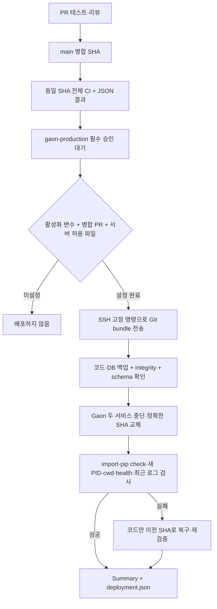

# Gaon CI/CD 운영 계약

상태: **구현은 검토용이며 배포는 기본 비활성**이다. 서버/Environment/Secrets를
이 변경이 설치하거나 생성하지 않는다. 첫 운영 배포를 실행하지 않는다.
기준 운영 상태는 사용자가 제공한 `mymoneyguard`, `/opt/strategylab-v2`, `04a65f8`,
DB `/var/lib/strategylab/gaon-runtime.sqlite`다. 서버 상태를 이번 클라우드에서 확인한 것은 아니다.

## 배포 경로와 중단 조건



- `verify.yml`: PR의 기존 Linux 3.11/3.12, Windows 3.12 CI를 유지하고 JSON 아티팩트와
  workflow actionlint 검증을 추가한다. 기존 compatibility CI도 유지한다.
- `gaon-production.yml`: main push 또는 main에서의 수동 실행만 배포 대상이다.
  테스트 실패 시 `needs: verify`가 SSH job을 시작하지 않는다. 직접 push로 PR 근거가
  없거나 CI 아티팩트의 SHA가 다르면 배포하지 않는다. `continue-on-error`는 없다.
- 배포 job은 `gaon-production` Environment 승인 후에만 진행한다. 기본 변수 미설정은
  disabled다. root-owned `/etc/gaon-deploy/enabled`도 없으면 서버는 배포하지 않는다.
- concurrency는 `gaon-production`, 실행 중 취소는 false다. root broker의 별도 flock으로 직렬화한다.
- SSH 계정은 checkout 쓰기 권한이 없다. root 소유 `deployment_broker.py`가 root 소유
  `deploy_worker.py`만 `/usr/bin/python3 -I`로 실행하며, **exec 전에 strategylab UID/GID로
  내리고 supplementary groups를 비운다**. root가 checkout/venv/애플리케이션 스크립트를 실행하지 않는다.
- broker는 공개 GitHub API에서 현재 main SHA, 병합 PR, 정확한 run/attempt/workflow/main,
  CI 성공 job, Environment gate를 지난 실행 중인 배포 job을 독립 대조한다. SSH 인자로 받은
  PR 번호나 실행 번호 자체는 승인 증거가 아니다. API 오류·rate limit·대기/완료된 job은 거부한다.
  현재 공개 저장소를 대상으로 하며 서버에서 api.github.com HTTPS 접근이 필요하다.
- 서버는 pip/apt 설치를 하지 않는다. 기존 venv의 editable import와 `pip check`만 검사한다.
  의존성 선언, migration 소스, DB 버전 변경은 **자동 배포 불가**다. 별도 검토·수동 준비가 필요하다.
- 원래 서비스 두 개가 정상인 상태만 시작점으로 허용한다. 실제 실행 중인 HEAD를 기록하고
  Git archive와 SHA256으로 코드 백업, SQLite online backup과 integrity 검사로 DB 백업한다.
  DB 백업은 root 전용 `/var/backups/gaon-cicd/<run>-<attempt>/`다.
  기존 `/var/lib/strategylab/backups/pr256/`, `deploy_backups/`는 삭제/정리/덮어쓰기하지 않는다.
- checkout은 `git switch --detach <full SHA>`이며 reset/clean/강제 checkout은 없다.
  로컬 추적 파일 변경은 거부하고, `deploy_backups`, `.venv`, `.env` 경로의 대상 변경도 거부한다.
- 새 프로세스 PID, 고정 WorkingDirectory, 정확한 HEAD, editable import 경로가 모두 일치할 때만
  `running_sha`를 기록한다. 이는 endpoint가 직접 서명한 SHA가 아니라 **재시작+프로세스+코드 증거**다.
- 실패하면 코드만 이전 SHA로 복구한다. DB 변경을 되돌리거나 백업을 자동 복원하지 않는다.
  DB가 이전 코드와 호환되지 않거나 복구 health도 실패하면 Gaon 서비스를 중단하고 수동 복구로 남긴다.
- 원시 journal, 환경 변수 값, SSH private key, 계좌/거래 키는 보고서로 전송하지 않는다.
  journal은 해당 두 unit의 배포 이후 최대 2,000건에서 오류 개수만 보고한다.
  SSH 단절/부분 JSON/다른 실행 결과는 unknown이며 성공으로 추정하지 않는다.
- 이 경로는 전략 레지스트리나 Passkey 승인 데이터를 변경하는 명령을 실행하지 않는다.
  애플리케이션의 정상 연구 쓰기는 계속 가능하며 자동 전략 승격을 추가하지 않는다.

## GitHub 설정 — 저장소 관리자가 한 번 수행

1. Settings → Environments에서 **먼저** `gaon-production`을 만든다.
   Required reviewers(담당자/팀), Prevent self-review, 가능한 경우 관리자 우회 금지를 설정한다.
   Deployment branches/tags는 selected branch **main만** 허용한다. 태그는 허용하지 않는다.
   이 기능을 지원하는 저장소 요금제/정책인지 확인한다. 지원하지 않으면 활성화하지 않는다.
2. main 보호 규칙에서 PR·리뷰·CI 필수 통과를 요구한다. 적어도 PR Fast Verify의 세 테스트와
   `Deployment workflow syntax and expressions`를 필수 검사로 지정한다. 직접 main push를 제한한다.
3. 아래 두 Secrets를 **Environment 범위**로만 저장한다. 값은 채팅/커밋에 적지 않는다.

   | 종류 | 이름 | 의미 |
   |---|---|---|
   | Secret | `GAON_DEPLOY_SSH_KEY` | 전용 gaon-deploy 계정의 SSH private key |
   | Secret | `GAON_DEPLOY_KNOWN_HOSTS` | 별도 신뢰 경로로 확인한 서버 host key 행. 비표준 포트면 `[host]:port` 형식 |
   | Variable | `GAON_DEPLOY_HOST` | 러너에서 도달 가능한 서버 DNS/IP. 로컬 별칭 mymoneyguard만으로 도달한다고 가정하지 않음 |
   | Variable | `GAON_DEPLOY_PORT` | SSH port, 기본 22 |
   | Variable | `GAON_DEPLOY_ENABLED` | 최초에는 **false**. 검증 완료 후 담당자가 true로 변경 |
   | Repository variable (선택) | `GAON_DEPLOY_RUNNER` | 배포 전용 Linux runner label. 기본 ubuntu-latest |

4. mymoneyguard가 Tailscale 내부에서만 도달 가능하면 private network에 있는 **전용 배포 runner**를
   지정한다. 운영 서버 자체를 PR용 self-hosted runner로 사용하지 않는다. CI는 GitHub-hosted에서
   실행한다. 이 PR은 VPN 설치/서버 방화벽 완화/공개 SSH 노출을 자동 수행하지 않는다.
5. workflow는 read-only contents, 배포 job의 PR 조회에만 pull-requests:read를 사용한다.
   저장소 쓰기·id-token·환경/Secrets 관리 권한을 workflow token에 부여하지 않는다.
   공식 actions는 조회한 전체 commit SHA에 고정했다. 변경 시 별도 리뷰한다.

Environment가 없는 상태에서 workflow가 이름만으로 생성하는 환경은 **보호된 환경이 아니다**.
코드에 environment 이름이 있다는 것만으로 승인 설정 완료라 보고하지 않는다.

## 서버 설정 — 기존 관리자 계정으로 수동 준비, root SSH 로그인 금지

아래는 **미실행 설치 예시**다. 현재 소유권, 실제 서비스 계정/경로를 먼저 확인한다.
`<REVIEWED_HELPER_CHECKOUT>`은 병합·검토된 이 PR의 helper 소스가 있는 별도 경로다.
운영 checkout을 먼저 바꾸거나 기존 .env/venv/deploy_backups를 덮어쓰지 않는다.

서버 확인 결과(2026-10-22, PR 작성자 제공)는 checkout 소유자가
`strategylab:strategylab`, mode 0755, 두 unit의 User가 `strategylab`,
gaon-deploy UID 995, 실행 HEAD `04a65f8`이다. 클라우드에서 서버를 재검증하지 않았다.
기존 gaon-deploy를 다시 만들거나 checkout 소유권을 변경하지 않는다.

```bash
id gaon-deploy
id strategylab
/usr/bin/python3 --version  # Python >= 3.11
/usr/bin/git --version     # 보안 업데이트된 배포판 Git
sudo stat -c '%U:%G %a %n' /opt/strategylab-v2 /opt/strategylab-v2/.git
sudo install -d -m 700 -o root -g root /var/lib/gaon-deploy-root
sudo install -d -m 700 -o strategylab -g strategylab /var/lib/gaon-deploy-worker
sudo install -d -m 755 -o root -g root /usr/local/libexec /etc/gaon-deploy
sudo install -m 644 -o root -g root \
  <REVIEWED_HELPER_CHECKOUT>/deploy/cicd/ssh_deploy.py /usr/local/libexec/gaon-ssh-deploy.py
sudo install -m 644 -o root -g root \
  <REVIEWED_HELPER_CHECKOUT>/deploy/cicd/service_control.py /usr/local/libexec/gaon-service-control.py
sudo install -m 644 -o root -g root \
  <REVIEWED_HELPER_CHECKOUT>/deploy/cicd/deploy_worker.py /usr/local/libexec/gaon-deploy-worker.py
sudo install -m 644 -o root -g root \
  <REVIEWED_HELPER_CHECKOUT>/deploy/cicd/deployment_broker.py /usr/local/libexec/gaon-deployment-broker.py
sudo install -m 755 -o root -g root \
  <REVIEWED_HELPER_CHECKOUT>/deploy/cicd/deployment-broker /usr/local/sbin/gaon-deployment-broker
```

gaon-deploy에는 `.git`, `src/gaon`의 쓰기 권한이나 strategylab 그룹을 추가하지 않는다.
`chown -R`, 광범위 ACL, `sudo -u strategylab python/bash/git` 허용은 금지한다.
venv·DB·기존 백업·거래 키의 권한을 변경하지 않는다. `deploy_backups/`를 보존한다.
root broker와 상위 디렉터리는 root 소유이며 group/other 쓰기·symlink가 없어야 한다.
worker도 root 소유지만 **실행 자격은 strategylab**이다. root는 writable venv Python을 실행하지 않는다.

`deployment-broker` wrapper 내용은 다음 고정 exec뿐이다. 인자에 경로나 명령을 받지 않는다.

```sh
#!/bin/sh
exec /usr/bin/python3 -I /usr/local/libexec/gaon-deployment-broker.py "$@"
```

`sudo visudo -f /etc/sudoers.d/gaon-deploy`로 다음 **하나의 broker만** 허용한다.

```sudoers
Defaults:gaon-deploy env_reset
Defaults:gaon-deploy secure_path=/usr/sbin:/usr/bin:/sbin:/bin
gaon-deploy ALL=(root) NOPASSWD: NOSETENV: /usr/local/sbin/gaon-deployment-broker deploy *
```

이전 `/usr/local/sbin/gaon-service-control` 직접 sudo 허용 항목이 있으면 관리자가 해당 항목만
제거한다. worker/strategylab에는 sudo 권한을 추가하지 않는다. wrapper 뒤 wildcard는 shell
해석이 아니라 sudo 인자 매칭이며, Python broker가 **deploy SHA run-attempt PRs 네 인자만**
재검증한다. 임의 shell·경로·추가 인자를 거부한다. `sudo visudo -cf /etc/sudoers.d/gaon-deploy`로 검사한다.

root broker가 `service_control.py`를 root 소유 고정 경로에서만 읽는다. systemctl은 `start/stop`과
`strategylab-gaon.service`, `gaon-web.service` 두 unit만 허용한다. backup/inspect/status는
고정 DB와 고정 백업 위치만 사용한다. 임의 명령·경로·unit·DB 복원 operation은 없다.
deploy 계정에 `systemctl *`, `sudo bash`, `sudo python`, `ALL=(ALL) ALL`은 부여하지 않는다.
root helper와 그 상위 디렉터리는 deploy/runtime 사용자가 수정할 수 없어야 한다.
helper 업데이트도 자동 CD가 아니라 별도 관리자 리뷰/설치 작업이다.

다음은 관리자 계정에서 수행하는 **읽기·거부 검사**이며 서비스 재시작은 하지 않는다.

```bash
sudo -u gaon-deploy test ! -w /opt/strategylab-v2/.git
sudo -u gaon-deploy test ! -w /opt/strategylab-v2/src/gaon
sudo -u gaon-deploy /usr/bin/git -c safe.directory=/opt/strategylab-v2 -C /opt/strategylab-v2 rev-parse HEAD
sudo -u strategylab /opt/strategylab-v2/.venv/bin/python -I -c \
  'import pathlib,gaon; assert pathlib.Path(gaon.__file__).resolve().parent == pathlib.Path("/opt/strategylab-v2/src/gaon")'
sudo -u gaon-deploy sudo -n -u strategylab /usr/bin/id  # 거부되어야 함
sudo -u gaon-deploy sudo -n /usr/local/sbin/gaon-deployment-broker restart MyMoneyGuard.service  # 거부
sudo -u gaon-deploy sudo -n /usr/local/sbin/gaon-deployment-broker deploy invalid 1-1 257  # 거부
sudo test ! -e /etc/gaon-deploy/enabled
```

Git safe.directory 예외는 위 읽기 명령에만 한정한다. root Git을 실행하거나 `safe.directory=*`를
추가하지 않는다. root broker의 Git 조회/worker Git 쓰기는 모두 strategylab UID/GID다.
`/var/lib/gaon-deploy-root`는 root lock·체크포인트·보고서·수신 spool, worker 디렉터리는
strategylab의 임시 bundle·코드 백업이다. 두 경로를 gaon-deploy에 개방하지 않는다.

root가 관리하는 SSH 설정의 해당 계정 범위에만 적용한다 (기존 다른 서비스/로그인은 바꾸지 않음).

```sshdconfig
Match User gaon-deploy
    AuthenticationMethods publickey
    PasswordAuthentication no
    KbdInteractiveAuthentication no
    PermitTTY no
    DisableForwarding yes
    PermitUserRC no
    AuthorizedKeysFile /etc/ssh/authorized_keys/%u
    ForceCommand /usr/bin/python3 -I /usr/local/libexec/gaon-ssh-deploy.py
```

`/etc/ssh/authorized_keys/gaon-deploy`는 root 소유, 계정이 수정할 수 없는 경로다.
공개키 행에는 `restrict`를 붙인다. SSH agent/port/X11 forwarding, PTY, rc와 임의 shell 명령을
허용하지 않는다. 관리자가 host key fingerprint를 별도 경로로 확인하여 known_hosts Secret에
입력한다. CI에서 ssh-keyscan한 값을 무조건 신뢰하거나 StrictHostKeyChecking을 끄지 않는다.
설정 문법은 관리자가 `sshd -t`, sudoers는 `visudo -cf`로 검사한다. 변경 적용은 관리자의 별도
서버 접근 정책에 따른다. 이 PR/워크플로는 sshd나 서버 전체 서비스를 재시작하지 않는다.

## 활성화 전 확인과 첫 승인

- 현재 HEAD가 제공된 `04a65f8`의 전체 SHA와 일치하는지, tracked 수정이 없는지 확인한다.
- 실제 두 unit의 실행 사용자/WorkingDirectory/ExecStart가 저장소 예시와 일치하는지 확인한다.
  runtime은 migration owner, web은 non-owner라는 기존 계약을 유지한다.
- 기존 venv import 경로와 의존성 충돌, SQLite integrity/schema=48, 디스크 여유를 확인한다.
- helper/SSH/sudoers의 허용·거부를 검증한다. 임의 unit, 다른 인자, shell 접속을 거부해야 한다.
  직접 broker의 stop/start를 운영에서 시험하지 말고 먼저 격리된 테스트 서버에서 검증한다.
- 신규 DB 백업/코드 백업 위치의 쓰기 및 소유권과 기존 pr256/deploy_backups 보존을 확인한다.
- cloud 테스트는 실제 SSH/systemd/host key/네트워크/Environment 보호를 검증하지 못한다.
  실제 설정을 담당자가 확인하기 전에는 완료로 표시하지 않는다.
- `GAON_DEPLOY_ENABLED=false`, 서버 허용 파일 **없음** 상태로 병합한다. 처음 생성되는
  Environment job은 필수 리뷰 대기로 두며 승인하지 않는다. 설정 확인과 staging 실패/복구
  연습 후에만 관리자에게 실제 운영 배포 활성화를 요청한다.
- 활성화 결정 후에만 관리자가 root-owned `/etc/gaon-deploy/enabled`에 `enabled` 한 줄을 넣고
  GitHub variable을 true로 바꾼다. 그 후 main workflow를 새로 수동 실행하고 담당자가 승인한다.
  이 문서 작성/PR 생성만으로 해당 조치를 수행하지 않는다.

즉시 비활성화하려면 variable을 false로 설정하고 서버 허용 파일을 제거한다. 실행 중인
배포를 무작정 cancel하거나 프로세스를 kill하면 상태는 unknown일 수 있으므로 보고서와 두
Gaon 서비스 상태를 확인한다. 운영 DB 복구는 절대 자동 수행하지 않으며 기존
[수동 복구 절차](../../docs/operations/GaonAuditDeployment.md)를 따른다.

## 신뢰 경계·중단·복구 검증

- SSH 입구는 최대 256 MiB의 v2 bundle과 선언된 HEAD를 검사한다. root broker는 별도
  root 전용 spool로 다시 복사하고 180초/256 MiB를 제한한다. 입구가 제공한 파일 경로는
  받지 않고, root가 연 read-only stdin만 worker에 넘긴다. 실제 Git pack 파싱은 root가
  아니라 strategylab worker의 **새 빈 bare quarantine**에서 수행한다. 기존 객체 캐시로
  손상 pack 검사가 생략되지 않도록 quarantine에서 `bundle verify`, `fetch HEAD`, 정확한
  FETCH_HEAD SHA, commit 타입, `fsck --strict`를 모두 통과한 객체만 checkout으로 옮긴다.
  CI가 만드는 전체 history bundle만 지원하며 prerequisite가 필요한 incremental bundle은 거부한다.
- Git hook/fsmonitor/외부 diff·submodule 재귀를 끄고 로컬 filter/diff/url rewrite/include/worktree/sshCommand 구성을
  거부한다. 의존성·migration·`.env`·`.venv`·`deploy_backups` 변경도 계속 거부한다.
  Git parser 자체의 보안 업데이트와 디스크 용량 관리가 필요하며, 압축 파일 크기 제한은
  완전한 압축폭탄/자원 격리가 아니다. 검토·승인된 main 코드만 허용하는 것이 코드 실행 신뢰 경계다.
- root의 API 조회는 main SHA/병합 PR뿐 아니라 run-attempt, workflow 경로, main branch,
  CI 성공, 실행 중인 Environment 배포 job을 확인하고 중단 직전에 다시 확인한다.
  main이 그 사이 바뀌거나 승인 대기/완료된 run을 재사용하면 거부한다. Environment의
  required reviewers/main 전용 정책은 관리자가 실제 설정해야 하며 job 이름만으로 보호 설정
  완료를 주장하지 않는다. GitHub API 장애/공개 API rate limit에서는 배포를 중단한다.
- 서비스 중단 전에 root가 기존 HEAD·schema를 독립 조회하고
  `/var/lib/gaon-deploy-root/active.json`에 이전 SHA/대상/run을 fsync한다. 부분 stop도
  stopped 상태를 먼저 기록한다. worker의 SIGTERM/SIGHUP는 RPC/Git 작업 종료 후 전달해
  미수신 응답이나 중간 Git lock으로 롤백이 어긋나지 않게 한다.
- SSH 단절/worker crash/강제 종료 후 root supervisor는 이전 SHA의 **고정 recover 작업**을
  strategylab worker로 수행한다. DB는 복원하지 않는다. 코드 import·DB schema·health가
  맞지 않으면 두 Gaon unit만 중단하고 `manual_recovery_required`와 체크포인트를 남긴다.
  root 자체의 SIGKILL/서버 전원 장애는 자동 복구를 보장하지 않는다. 남은 active.json은
  다음 자동 배포를 차단하므로 관리자가 상태를 확인하기 전 삭제하지 않는다.
- 원래 strategylab 계정은 checkout/DB/venv의 신뢰된 소유자다. 동일 UID가 이미 침해된 경우의
  checkout 경합·worker 조작까지 차단하는 sandbox가 아니다. worker는 새 supplementary
  group을 받지 않으며 root 코드를 실행하지 않는다. 다른 실거래/MyMoneyGuard 키 파일은
  원래부터 strategylab/gaon-deploy가 읽지 못하는 별도 소유권이어야 한다. 관리자가 경로의
  `test ! -r`만 확인하고 키 내용은 출력하지 않는다. 해당 서비스/키의 설정을 이 PR로 바꾸지 않는다.

격리된 staging에서 먼저 실제 UID 전환, SSH 강제 명령, sudoers, 승인 API 응답, 정상 배포,
부분 stop/단절/실패 import/불일치 bundle/복구 실패를 검증한다. 클라우드 테스트는 실제
서버 root 권한·sshd·systemd·Environment 설정을 대신 검증하지 않는다.

root supervisor 자체가 죽은 경우의 **관리자 수동 복구 초안**(운영에서는 별도 승인 후 수행):

1. `GAON_DEPLOY_ENABLED=false`, enabled 파일 없음 상태로 두고 root 보고서와 active.json을 읽는다.
2. journal의 `previous_sha`가 정확한 40자리 SHA이고 해당 객체가 있는지 관리자 계정으로 확인한다.
   journal이 없거나 SHA/DB schema를 확인할 수 없으면 임의 SHA를 선택하지 않는다.
3. 관리자만 고정 service_control.py의 `stop-web`, `stop-runtime`을 실행한다. 다른 unit은 금지한다.
4. 관리자만 `sudo -u strategylab /usr/bin/git -C /opt/strategylab-v2 switch --detach <검증한 previous_sha>`로
   코드 복구 후 위의 venv `-I` import와 `-I -m pip check`, DB inspect/schema 호환성을 검사한다.
   강제 checkout/reset/clean, lock 임의 삭제, DB 복원을 하지 않는다. 실패하면 서비스를 중단 상태로 둔다.
5. 호환될 때만 관리자에게 두 unit의 start와 loopback `/gaon/health`, PID/cwd/최근 오류 검증을 요청한다.
   결과를 기록하고 체크포인트는 관리자 검증 후 별도 보관한다. 이 절차는 자동 실행되지 않는다.

## ChatGPT가 읽을 증거 경로

인증된 GitHub 연결에는 이 저장소의 **Actions read**, contents read, PR read가 필요하다.
ChatGPT에 SSH/private key나 운영 서버 접근권을 주지 않는다.

1. 최신 main 실행: `GET /repos/Choi0211/StrategyLab-v2/actions/workflows/gaon-production.yml/runs?branch=main&per_page=10`.
   waiting/queued/in_progress인 최신 실행을 건너뛰고 과거 성공을 최신으로 소개하지 않는다.
2. 해당 run: `GET /repos/Choi0211/StrategyLab-v2/actions/runs/<run_id>` 및 `/jobs`.
   workflow URL은 `https://github.com/Choi0211/StrategyLab-v2/actions/runs/<run_id>`.
3. `/actions/runs/<run_id>/artifacts`에서 **해당 attempt**의
   `gaon-deployment-<run_id>-<attempt>`를 찾아 인증된 archive 다운로드 URL로 읽는다.
   `deployment.json`과 `ci.json`을 확인한다. retention은 90일이며 삭제/만료는 미확인이지 성공이 아니다.
4. 승인 전에는 deployment artifact가 아직 없을 수 있다. CI artifact
   `gaon-ci-<run_id>-<attempt>`, job/environment의 대기 상태를 보고한다.

예시 조회 (인증은 기존 GitHub 연결 사용):

```bash
gh run list --repo Choi0211/StrategyLab-v2 --workflow gaon-production.yml --branch main --limit 10
gh run view <run_id> --repo Choi0211/StrategyLab-v2 --json status,conclusion,headSha,url,jobs
gh run download <run_id> --repo Choi0211/StrategyLab-v2 \
  --name gaon-deployment-<run_id>-<attempt> --dir ./gaon-deployment-report
```

`deployment.json`은 PR 번호(여러 개면 배열), 대상/이전/실행 SHA, CI의 suite별 결과·실행/skip 수,
배포 시작/종료 UTC 시각, 서비스별 PID/state/cwd, API health, DB schema, 코드·DB 백업,
최근 오류 개수, rollback 시도/성공, `db_restored=false`, 실행 URL, 활성화 상태를 포함한다.
workflow Summary에도 핵심 결과가 표시된다. 서버에는 같은 실행 ID의 보고서가
root 전용 `/var/lib/gaon-deploy-root/reports/`에 남는다. GitHub 연결 도구가 Actions/artifact 다운로드를
지원하는지는 별도 확인해야 한다. 이 채팅에서의 실제 GitHub API/운영 배포 검증은 미완료다.

이전 `upgrade_service.sh`/`rollback_service.sh`는 레거시 수동 도구이며 새 CD에서 호출하지 않는다.
특히 레거시 rollback의 DB 자동 복원 동작을 이 파이프라인에 연결하지 않는다.

## 대기열 및 복구 보완

[배포 대기열·중복·실패 보고와 남은 서버 검증](../../docs/operations/gaon-deployment-recovery.md)을
함께 확인한다. 승인 대기는 전역 workflow 슬롯을 점유하지 않으며, 실제 서비스 변경은
기존 root broker lock과 journal로 직렬화한다. 자동 승인을 추가하지 않는다.
